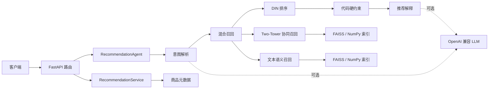

# AgentRec 主体代码详解与无外置资源运行检查

## 1. 文档目的

本文面向需要阅读、运行或继续维护 AgentRec 的开发者，说明项目的主体结构、核心数据流、主要类与函数、降级行为和运行边界。

本文还记录了 2026-09-14 在当前仓库和当前机器环境中完成的一次“无外置资源”检查。这里的外置资源包括：

- Amazon Reviews 等原始数据集；
- 预处理后的 Parquet 文件；
- Two-Tower、DIN 等训练权重；
- 协同/语义向量和 FAISS 索引；
- Qwen、BGE 等本地模型目录；
- LLM、Embedding HTTP 服务；
- 为检查而临时联网下载的任何数据或模型。

因此，本次检查回答的是两个不同的问题：

1. 项目源码和不依赖外置资源的核心算法是否具备可执行性；
2. 当前机器的 Python 环境是否已经满足完整启动条件。

结论是：**源码可以编译，合成样本下的核心数据、召回、排序、Agent 降级逻辑可以执行；但当前 Python 环境没有正确安装项目依赖，因此当前状态不能直接启动 API 或执行官方 pytest 测试命令。**

## 2. 系统全貌

AgentRec 是一个分层的混合推荐系统。推荐候选必须来自检索结果，LLM 只参与意图解析和推荐理由生成，不能自行创造商品，也不负责最终执行价格、类别等硬约束。



离线链路负责产生在线服务需要的文件：

```text
原始交互/商品元数据
  -> preprocess.py
  -> processed/*.parquet + id_mappings.json
  -> train_retriever.py
  -> two_tower.pt
  -> build_faiss.py
  -> collaborative/semantic embeddings + indexes
  -> train_ranker.py
  -> din.pt
  -> evaluate.py
  -> evaluation.json
```

在线链路负责处理请求：

```text
POST /recommend
  -> RecommendationService.recommend
  -> 混合召回 -> 去除已交互商品 -> DIN/召回分排序 -> 补充商品元数据

POST /chat
  -> RecommendationAgent.run
  -> 意图解析 -> 召回 -> 排序 -> 类别/价格硬过滤 -> 解释
```

## 3. 目录和职责

| 目录/文件                | 主要职责                                  |
| -------------------- | ------------------------------------- |
| `configs/`           | 本地/服务器环境、召回器、排序器和 Agent 参数            |
| `src/common/`        | 配置加载、日志、随机种子、JSON/Checkpoint 原子写入     |
| `src/data/`          | 数据读取、清洗、k-core、ID 映射、时间切分、特征和 Dataset |
| `src/recsys/models/` | Two-Tower 与 DIN 的 PyTorch 定义          |
| `src/recsys/`        | 训练、索引检索、混合召回、在线排序、指标和评估               |
| `src/embedding/`     | 商品/查询文本编码和索引构建                        |
| `src/services/`      | 商品服务、推荐编排服务、LLM 客户端                   |
| `src/agent/`         | Agent 状态、节点、LangGraph/顺序执行工作流         |
| `src/api/`           | FastAPI 应用、路由和 Pydantic 数据结构          |
| `scripts/`           | 各 Python 入口的 Shell 包装脚本               |
| `tests/`             | 合成样本上的数据、召回、排序、Agent 和 API 测试         |

`notebooks/analysis.ipynb` 用于分析，不是生产调用链的一部分。

## 4. 配置系统

### 4.1 配置加载顺序

`src/common/config.py` 是所有入口的共同起点。`load_config()` 按以下顺序合并配置：

1. 加载 `.env`，如果未安装 `python-dotenv` 则跳过；
2. 加载 `configs/local.yaml` 或 `configs/server.yaml`；
3. 依次递归合并 `retriever.yaml`、`ranker.yaml`、`agent.yaml`；
4. 如果传入 `--config`，再合并自定义 YAML；
5. 最后用 `AGENTREC_*` 环境变量覆盖部分字段；
6. 把 `data_root` 和 `artifact_root` 解析为绝对路径。

后加载的值优先级更高。`deep_merge()` 会递归合并字典，而不是用整个子字典覆盖原配置，因此自定义配置可以只写需要修改的字段。

### 4.2 环境变量展开

`read_yaml()` 在 YAML 解析前调用 `_expand_environment()`，支持：

```text
${VARIABLE}
${VARIABLE:-default-value}
```

没有默认值且环境变量不存在时会直接抛出 `KeyError`，可以尽早发现错误配置。

### 4.3 路径辅助函数

- `data_path(config, *parts)`：从 `data_root` 拼数据路径；
- `artifact_path(config, *parts)`：从 `artifact_root` 拼产物路径；
- `config_value(config, "a.b.c")`：读取嵌套字段，字段不存在时返回默认值。

项目所有数据和产物位置都通过配置接入，仓库本身不需要保存大文件。

## 5. 数据处理主体

### 5.1 多格式读取

`src/data/preprocess.py::read_dataframe()` 根据后缀读取 JSON、JSONL、GZip JSON、CSV 或 Parquet。原始字段名不必固定，`_canonicalize()` 会依据 `data.columns` 把配置中的字段重命名为统一的：

```text
user_id, item_id, timestamp, label,
title, category, price, description, features
```

### 5.2 清洗和 k-core

`preprocess()` 的主要步骤是：

1. 检查交互文件和 `user_id/item_id/timestamp` 必需列；
2. 删除必需字段为空的行；
3. 把原始用户和商品 ID 转为字符串，避免不同输入类型导致映射不稳定；
4. 缺少 `label` 时默认设置为 `1.0`；
5. 用 `iterative_k_core()` 反复删除交互过少的用户和商品；
6. 为用户、商品建立从 1 开始的连续整数 ID；
7. 合并商品元数据并规范化文本、价格；
8. 按用户时间切分训练/验证/测试集；
9. 写出 Parquet 和 ID 映射。

连续 ID 从 `1` 开始非常重要：模型把 `0` 保留给 padding，尤其是 DIN 的历史序列补齐。

`iterative_k_core()` 需要迭代执行，因为删除低频用户后可能让某些商品变成低频，删除低频商品后又可能让用户不再满足阈值。函数直到本轮数据行数不再变化才返回。

### 5.3 商品文本规范化

`_text_value()` 将 Amazon 元数据中常见的数组和字典字段转成文本：

- 列表用 `" > "` 连接，例如 `['Skin Care', 'Face']` 变成 `Skin Care > Face`；
- 字典被转成 `key: value` 片段；
- 空列表、空字典、空字符串、NaN 和 `None` 都变成空字符串。

服务器配置把 `categories` 作为主类别，把 `main_category` 作为回退字段。`description` 和 `features` 即使是数组也能进入后续语义编码。

### 5.4 时间切分与防泄漏

`src/data/split.py::split_by_user_time()` 对每个用户按时间排序：

- 至少 2 条交互：最后一条进入测试集；
- 至少 3 条交互：倒数第二条进入验证集；
- 其余交互进入训练集。

排序同时使用原始行号作为同时间戳的稳定次序。`_sortable_timestamp()` 优先识别数值时间戳；如果大部分值不是数值，则按 UTC 日期解析。

`assert_no_temporal_leakage()` 检查：

```text
max(train_time) <= min(valid_time) <= min(test_time)
```

这保证不会把用户的未来行为放进训练历史。

### 5.5 历史序列特征

`src/data/features.py::attach_user_histories()` 逐行维护每个用户的历史列表。当前样本只会看到它之前发生的行为，不会把当前商品或未来商品加入历史。

`pad_history()` 只保留末尾 `max_length` 个商品，并在左侧补 0。例如最大长度为 5，历史 `[8, 9]` 会变成 `[0, 0, 0, 8, 9]`。

`build_user_history_map()` 为在线 DIN 排序构建 `user_id -> 最近商品 ID 列表`。

### 5.6 PyTorch Dataset 与负采样

`RetrievalDataset` 每个样本输出：

```python
{
    "user_id": user_id,
    "positive_item_id": item_id,
    "negative_item_ids": [...],
}
```

负样本从 `[1, num_items]` 随机抽取，并排除该数据帧中用户的正样本。随机种子使用 `seed + index`，同一个样本在不同运行中可复现。

`RankingDataset` 输出用户、目标商品、定长历史、历史长度和二分类标签。`ranking_samples_with_negatives()` 为每条正反馈复制若干负样本，供 DIN 使用 `BCEWithLogitsLoss` 训练。

## 6. Two-Tower 协同召回

### 6.1 网络结构

`src/recsys/models/two_tower.py::TwoTower` 包含两个结构相同但参数独立的塔：

```text
user_id -> user_embedding -> MLP -> L2 normalize -> user_vector
item_id -> item_embedding -> MLP -> L2 normalize -> item_vector
```

每层塔由 `Linear -> ReLU -> LayerNorm` 组成。输出做 L2 归一化后，用户与商品的点积等价于余弦相似度。

### 6.2 前向和损失

正样本分数：

```text
s_pos = dot(user_vector, positive_item_vector)
```

负样本分数：

```text
s_neg[j] = dot(user_vector, negative_item_vector[j])
```

训练损失为成对 softplus：

```text
loss = mean(softplus(-(s_pos - s_neg)))
```

当正样本得分高于负样本时损失减小。`checkpoint_metadata()` 将模型尺寸和层结构一并保存，使在线加载不依赖重复手写架构参数。

### 6.3 训练循环

`src/recsys/train_retriever.py::train()`：

1. 读取 train/valid/users/items Parquet；
2. 创建负采样 Dataset 和 DataLoader；
3. 初始化 Two-Tower 和 AdamW；
4. 每个 epoch 训练并计算验证损失；
5. 只保存验证损失更好的 checkpoint；
6. 连续若干轮不提升时 early stopping；
7. 写出训练指标 JSON。

`_device()` 在配置要求 CUDA 但机器不可用时自动回退 CPU。

## 7. 向量索引和混合召回

### 7.1 DenseIndex

`src/recsys/retrieval.py::DenseIndex` 同时支持两种后端：

- 安装 FAISS 时使用 `IndexFlatIP`；
- 没有 FAISS 时，用 NumPy 矩阵乘法做精确检索。

建库和查询都会 L2 归一化，因此内积是余弦相似度。NumPy 后端适合测试和小数据，FAISS 后端适合生产数据规模。

`DenseIndex.load()` 可以只加载 `.faiss`，也可以只加载 `.npy`。如果二者都不可用则构造失败，避免创建一个无法检索的空索引。

### 7.2 协同召回器

`CollaborativeRetriever.retrieve()` 先检查用户 ID 是否在模型范围内，再调用 `TwoTower.encode_user()` 得到查询向量，最后交给 DenseIndex 搜索。未知用户直接返回空列表，不会错误访问 embedding 表。

### 7.3 语义召回器

`src/embedding/item_encoder.py::TextEncoder` 支持：

- 本地 `SentenceTransformer`；
- OpenAI 兼容 `/embeddings` HTTP 接口。

`ItemEncoder.item_text()` 将标题、类别、特征、描述拼成统一商品文本。`QueryEncoder` 用同一个文本编码器编码用户查询，保证商品向量和查询向量处在相同空间。

`src/embedding/build_faiss.py::build_indexes()` 一次生成：

- Two-Tower 商品向量和协同索引；
- 文本商品向量和语义索引；
- 索引位置对应的 `item_ids.json`。

### 7.4 混合召回

`src/recsys/hybrid_retrieval.py::HybridRetriever` 分别获取协同和语义候选。两个通道的原始分数不可直接比较，所以 `_normalize()` 在每个结果集内部做 min-max 归一化，再按配置权重融合：

```text
final_retrieval_score
  = collaborative_weight * collaborative_score
  + semantic_weight * semantic_score
```

相同商品通过 `item_id` 合并，只保留一条融合结果；最后按融合得分降序返回 `top_k`。

这套设计自然支持以下降级：

- 没有用户或用户未知：只走语义召回；
- 查询为空：只走协同召回；
- 某个召回器未加载：只使用另一个召回器。

## 8. DIN 精排

### 8.1 注意力机制

`src/recsys/models/din.py::DIN` 的目标是根据“当前候选商品”动态提取用户历史兴趣，而不是把整段历史固定平均。

对目标商品向量 `q` 和每个历史商品向量 `h`，构造：

```text
[q, h, q - h, q * h]
```

拼接后的向量通过注意力 MLP 得到权重。padding 位置会被 mask 成极小值，softmax 后再乘 mask 并重新归一化，因此全 padding 历史也不会产生 NaN。

加权历史向量为：

```text
interest = sum(attention_weight[i] * history_embedding[i])
```

最终将 `user_embedding`、`target_item_embedding`、`interest` 拼接，通过输出 MLP 得到一个 logit。`predict()` 对 logit 使用 sigmoid，返回 `[0, 1]` 概率。

### 8.2 训练和在线排序

`src/recsys/train_ranker.py` 将正负样本交给 DIN，用 `BCEWithLogitsLoss` 训练，并按验证损失保存最佳模型和执行 early stopping。

`src/recsys/ranker.py::DINRanker.rank()` 在在线阶段：

1. 取得用户最近历史并 padding；
2. 将所有候选组成一个 batch；
3. 调用 DIN 一次计算全部概率；
4. 写入 `ranking_score` 和统一的 `score` 字段；
5. 按分数降序返回。

未知用户、越界用户或空候选不会调用 DIN，而是保留召回分排序。这让冷启动请求仍有机会由语义通道完成。

## 9. 推荐服务编排

`src/services/recommendation_service.py::RecommendationService` 是推荐核心的门面层，屏蔽索引、模型、历史和元数据的具体实现。

### 9.1 资源装载

`from_config()` 依次完成：

1. 加载 `items.parquet`，这是服务可用的必要条件；
2. 可选加载 `users.parquet`，建立原始用户 ID 到内部整数 ID 的映射；
3. 可选加载训练交互，构建用户历史；
4. 检查 Two-Tower checkpoint、商品 ID 映射和协同索引；
5. 检查语义索引，并构建查询编码器；
6. 至少一个召回通道可用，否则抛出 `ResourceUnavailableError`；
7. DIN checkpoint 存在时加载精排器，否则使用召回分数。

因此，DIN 和 LLM 都不是基础推荐能力的强制资源，但商品元数据和至少一个召回索引是强制资源。

### 9.2 一次推荐请求

`recommend()` 的调用顺序为：

```text
resolve_user_id
  -> hybrid_retrieve(max(top_k * 5, top_k))
  -> 过滤用户已经交互过的商品
  -> DIN 排序；无 DIN 时复制 retrieval_score 到 score
  -> 截取 top_k
  -> ItemService 补充标题、类别、价格和描述
```

多召回一些候选再过滤，可以降低“去掉已看商品后结果不足”的概率。

`ItemService` 在初始化时建立内存字典，单商品查询不需要每次扫描 DataFrame。`_json_value()` 会把 NumPy 标量转为普通 Python 值，把 NaN 变为 `None`，便于 API JSON 序列化。

## 10. Agent 主体

### 10.1 状态结构

`src/agent/state.py::AgentState` 是一个 `TypedDict`，在节点间传递：

- 原始用户、查询和 top-k；
- 解析出的类别、最高价格、正负偏好；
- 内部用户 ID、候选集、排序结果、最终结果；
- 面向用户的文本响应。

字段设置为 `total=False`，允许每个节点只增加自己负责的字段。

### 10.2 五个节点

`RecommendationAgent` 固定执行五步：

1. `parse_intent`：解析类别、最高价格和偏好；
2. `retrieve`：调用 RecommendationService 混合召回；
3. `rank`：DIN/召回分排序，并补全商品元数据；
4. `filter_constraints`：用代码执行硬约束；
5. `explain`：生成每个真实商品的理由和总回复。

安装 LangGraph 且 `use_langgraph=true` 时，这五步被编译成线性 StateGraph；未安装 LangGraph 时自动使用普通 Python 循环按相同顺序执行。因此 LangGraph 是编排增强，不是业务逻辑的必要依赖。

### 10.3 LLM 降级

`parse_intent_node()` 优先用确定性正则解析“1000 元以内”“预算 1000”“under $1000”等价格表达。LLM 配置可用时，再请求结构化输出；LLM 请求或解析失败则保留确定性结果。

`explain_node()` 先为每个商品产生代码模板理由。LLM 可用时，只把最终商品的安全字段发给模型，并且只接受已有 `item_id` 的理由。LLM 失败后仍返回模板理由。

这意味着关闭 LLM 后：

- 推荐链路仍可运行；
- 最高价格可以由正则识别；
- 类别和更复杂偏好的理解会明显变弱；
- 推荐理由变为确定性模板。

### 10.4 硬约束为何在代码里

`filter_constraints_node()` 对排序结果逐条检查：

- 类别必须相等或包含请求类别；
- 价格必须存在且不能超过 `max_price`；
- 满足条件的商品达到最终 top-k 后立即停止。

LLM 不能绕过这一步。即使 LLM 给出了错误理由，最终商品集合仍由代码中的真实类别和价格决定。

## 11. API 层

`src/api/main.py::create_app()` 创建 FastAPI 应用并注册路由。应用生命周期首次启动时构造 `ServiceContainer`。

`ServiceContainer` 会分别尝试：

- 仅加载商品元数据；
- 加载完整 RecommendationService；
- 在推荐服务成功后创建 Agent。

资源错误被记录到 `details`，而不是直接阻止应用创建。`health()` 根据资源装载情况返回：

```json
{
  "status": "ok 或 degraded",
  "environment": "local",
  "resources": {
    "items": false,
    "recommendation": false,
    "agent": false,
    "llm": false
  },
  "details": []
}
```

LLM 不计入 `ok` 的必要条件，因为它有确定性降级路径。

`src/api/routes.py` 暴露：

| 方法   | 路径                 | 行为                       |
| ---- | ------------------ | ------------------------ |
| GET  | `/health`          | 返回资源状态和缺失原因              |
| GET  | `/items/{item_id}` | 查询商品；元数据未加载返回 503        |
| POST | `/recommend`       | 结构化推荐；推荐资源未加载返回 503      |
| POST | `/chat`            | Agent 推荐；Agent 未加载返回 503 |

Pydantic Schema 限制 `top_k` 在 1 到 100 之间，并保证响应字段稳定。服务内部异常被转换为 502，资源未装载则返回 503，两类错误语义不同。

## 12. 离线评估

`src/recsys/evaluate.py::evaluate()` 按用户聚合测试集真实商品，获取每个用户前 100 个推荐，计算：

- Recall@20、Recall@50、Recall@100；
- NDCG@10；
- HitRate@10；
- MRR。

`src/recsys/metrics.py` 中的指标函数都是无状态纯函数，便于独立单元测试。评估结果写到 `artifacts/metrics/evaluation.json`。

## 13. 无外置资源运行检查结果

### 13.1 已确认的仓库资源边界

本次扫描没有发现 `.pt/.pth/.bin/.safetensors/.faiss/.npy/.parquet/.jsonl` 数据或模型文件。`.gitignore` 也明确排除了 `data/`、`dataset/`、`artifacts/` 及常见权重、向量、索引、Parquet 文件。

本次没有调用数据预处理、训练、索引构建、LLM 或 Embedding 服务，也没有下载模型。

### 13.2 已通过的检查

| 检查                                 | 结果    | 说明                                                    |
| ---------------------------------- | ----- | ----------------------------------------------------- |
| Python 3.12 `compileall src tests` | 通过    | 全部源码和测试文件可编译                                          |
| Python 3.10 `compileall src tests` | 通过    | README 要求的 Python 3.10 基线可编译                          |
| 数据与算法合成测试                          | 7 项通过 | 数据切分、k-core、Dataset、Two-Tower、DenseIndex、混合召回、DIN、指标  |
| Agent 无 LLM 测试                     | 2 项通过 | 在隔离损坏的 HTTP 包后，顺序 Agent 和价格硬约束通过                      |
| CLI 模块装载                           | 3 项通过 | preprocess、train_retriever、train_ranker 的 `--help` 正常 |

合成测试没有读取外部数据，也没有加载训练权重。Two-Tower 和 DIN 使用测试代码即时创建的小型随机网络，只验证张量形状、数值有限性和控制流。

### 13.3 当前环境阻塞项

当前默认的 Python 是 `3.12.9`，但没有 `pip`，也没有安装 requirements 中的任何主要包，因此：

```text
python -m pytest -q
-> No module named pytest

python -m src.api.main --check --env local
-> No module named fastapi
```

机器上另一个 Python 3.10 环境有 PyTorch、Pandas、NumPy 等部分包，但该环境的依赖安装不完整：

- `pytest`、`pyarrow`、`faiss`、`langgraph`、`sentence_transformers` 缺失；
- `httpx`/`anyio` 依赖的 `sniffio` 缺失；
- `anyio` 包目录不完整，导不出 `CapacityLimiter`；
- `pip check` 还报告多个与本项目无关或间接相关的缺失包。

这导致以下入口在导入阶段失败：

- `src.embedding.build_faiss`；
- `src.recsys.evaluate`；
- `src.api.main`；
- 官方 API 测试和依赖 `LLMClient` 的 Agent 测试导入。

所以当前项目的准确状态是：

> 主体源码与核心算法冒烟测试正常，但当前机器没有一个完整、干净、符合 `requirements.txt` 的 Python 环境，完整服务不能在当前环境中直接运行。

这个结论与数据/模型是否存在无关。即使只期望 `/health` 以 `degraded` 模式启动，FastAPI 和 HTTP 依赖也必须先能正常导入。

## 14. 在不接入数据和模型时的推荐复检步骤

建议在一个干净的 Python 3.10+ 虚拟环境中执行：

```bash
python -m venv .venv
```

Windows：

```powershell
.venv\Scripts\Activate.ps1
python -m pip install -r requirements.txt
python -m compileall src tests
python -m pytest -q
python -m src.api.main --check --env local
```

Linux/macOS：

```bash
source .venv/bin/activate
python -m pip install -r requirements.txt
python -m compileall src tests
python -m pytest -q
python -m src.api.main --check --env local
```

如果仍不提供数据和模型，最后一个命令的**预期成功行为**不是 `status=ok`，而是进程正常退出并输出 `status=degraded`，同时列出缺失的 `items.parquet` 和召回资源。这个结果证明应用的降级启动链路正常，而不是证明推荐接口可用。

也可以启动 API 并只检查健康接口：

```bash
uvicorn src.api.main:app --host 127.0.0.1 --port 8080
```

此时：

- `/health` 应返回 200 和 `degraded`；
- `/items/{id}`、`/recommend`、`/chat` 应因资源未装载返回 503；
- 不应发生数据或模型下载。

## 15. 完整推荐服务需要的外置资源

当以后需要从“代码可运行”升级到“完整推荐可用”时，至少要接入：

```text
processed/items.parquet
faiss/item_ids.json
以下至少一套召回资源：
  - checkpoints/two_tower.pt + collaborative.faiss 或 collaborative.npy
  - semantic.faiss 或 semantic.npy + 可用的文本编码模型/接口
```

以下资源是可选增强：

- `processed/users.parquet`：原始用户 ID 映射；
- `processed/train.parquet`：过滤已交互商品、提供 DIN 历史；
- `checkpoints/din.pt`：精排；
- OpenAI 兼容 LLM：更好的意图理解和解释。

## 16. 维护时应关注的实现细节

以下不是本次无资源测试中的失败项，但从当前源码可见，后续维护时值得处理或补测。

### 16.1 已声明但当前未被消费的配置

- `api.allow_degraded_startup`：ServiceContainer 当前始终采用降级捕获逻辑，没有读取该开关；
- `retriever.top_k`：在线 Agent 使用 `agent.retrieval_top_k`；
- `agent.semantic_top_k`：当前没有单独控制语义候选数；
- `agent.explanation_max_items`：解释节点会处理全部最终商品；
- `.env.example` 中 `AGENTREC_LLM_MODEL_PATH`：配置加载器只读取 `AGENTREC_LLM_MODEL`。

这些字段容易让使用者误以为修改后会生效，建议后续选择“接入实现”或“删除配置”之一。

### 16.2 单通道召回分数的标定

HybridRetriever 初始化时始终把协同/语义权重归一化为固定和 1。当只有一个通道实际可用时，该通道仍只乘自己的原权重，例如只剩语义时最高融合分可能是 `0.35`。排序顺序不受影响，但对外暴露的分数与双通道场景不可直接比较。

### 16.3 语义资源健康检查是延迟的

`RecommendationService.from_config()` 看到语义索引就能构造 SemanticRetriever，但本地 SentenceTransformer 直到第一次查询才加载。因此即使健康状态显示 recommendation 已就绪，模型路径错误或依赖缺失仍可能在第一次语义请求时暴露。生产环境可增加一次启动期的轻量编码探针。

### 16.4 无 LLM 时只确定性解析价格

`_fallback_parse()` 当前不会解析类别、正偏好和负偏好，`preferences` 只是保存整段查询。关闭 LLM 后硬价格约束仍可靠，但类别约束通常不会触发。

### 16.5 召回验证负样本范围

训练召回器时，验证集单独构造 `RetrievalDataset(valid_frame, ...)`。该 Dataset 只把验证帧内的商品视为用户正样本，可能把用户在训练集中交互过的商品抽成验证负样本，从而让验证损失带有假负例。更严格的实现应让负采样器排除用户在训练和验证阶段已经出现的全部正样本。

### 16.6 仍缺少覆盖的路径

当前测试主要覆盖小型内存样本，尚未直接覆盖：

- Parquet 实际读写和完整 preprocess 输出；
- Two-Tower/DIN 完整训练循环、checkpoint 保存与重新加载；
- FAISS 后端；
- SentenceTransformer 和 HTTP Embedding；
- 真实 LLM 结构化输出异常；
- 资源缺失时真实 FastAPI 的 degraded/503 行为；
- 完整离线评估。

这些测试可以使用临时目录和极小合成数据补齐，不需要提交真实数据集或模型。

## 17. 阅读代码的建议顺序

第一次阅读项目时，建议按请求调用链而不是按目录字母顺序：

1. `src/api/main.py`：理解应用和资源容器；
2. `src/api/routes.py`：理解四个外部接口；
3. `src/services/recommendation_service.py`：理解推荐主流程和资源要求；
4. `src/recsys/hybrid_retrieval.py`、`retrieval.py`：理解候选如何产生；
5. `src/recsys/models/two_tower.py`：理解协同向量；
6. `src/recsys/models/din.py`、`ranker.py`：理解精排；
7. `src/agent/graph.py` 和 `src/agent/nodes/`：理解自然语言请求；
8. `src/data/preprocess.py`、`split.py`、`features.py`：理解模型输入从哪里来；
9. 两个训练入口、索引构建和 `evaluate.py`：理解离线闭环；
10. `tests/`：用最小示例确认各模块的契约。

按这个顺序，可以先掌握“线上一次请求发生了什么”，再回头看“这些资源如何训练和生成”。
